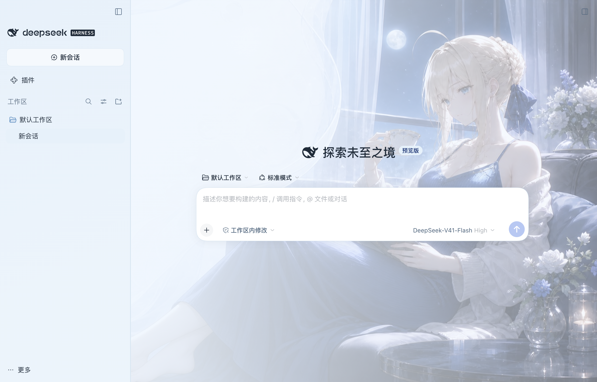
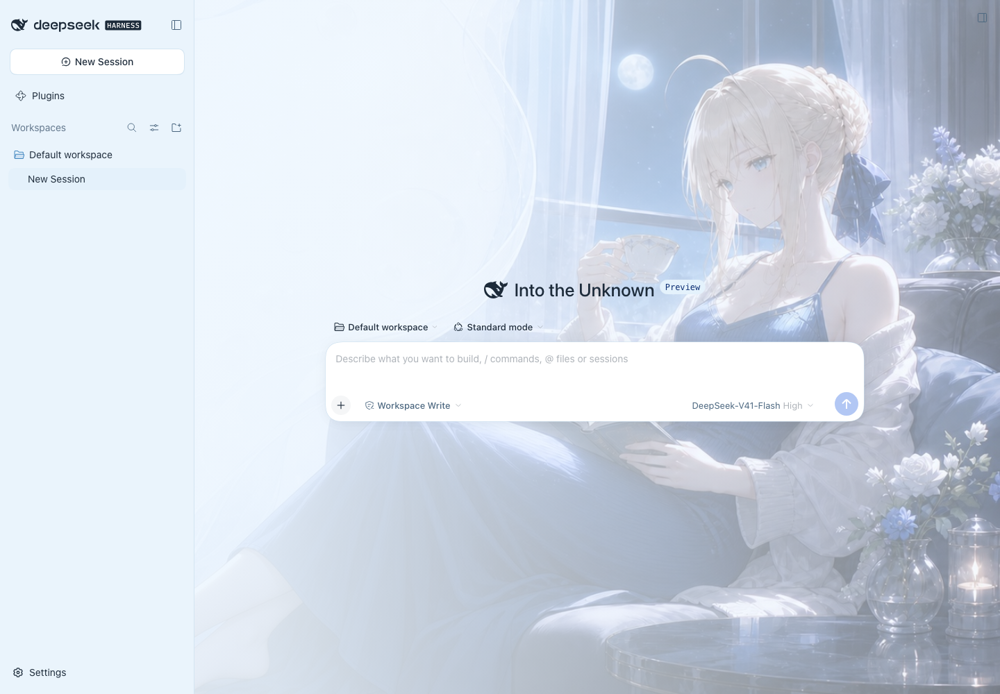
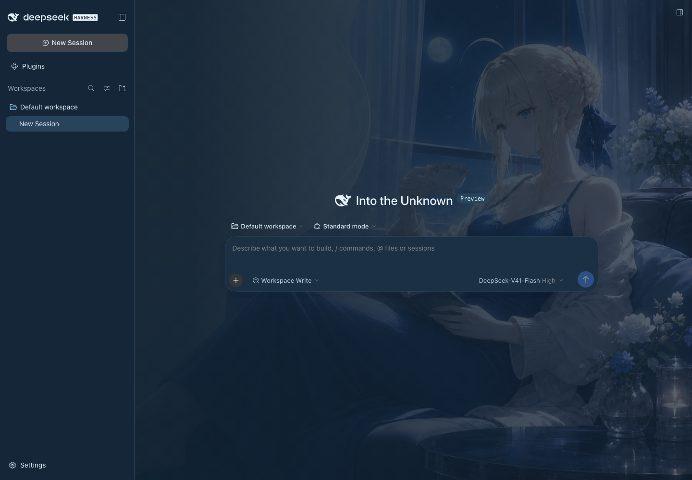

# Gord DSH Saber Theme

DeepSeek Harness 的 Saber 主题，参考 [Codex Saber Theme](https://github.com/nightosong/codex-saber-theme) 的 **Saber Ice Atelier** 风格：冰蓝、通透面板与 Saber 主视觉。

**当前版本：0.1.1** · [发布版本](https://github.com/nightosong/gord-dsh-saber-theme/releases/tag/v0.1.1)

使用 DSH 原生客户端插件，支持 **macOS / Windows**，以 **Desktop 桌面版为主，兼容 `dsh web`**，保留官方浅色/深色切换、字号设置、会话与窗口操作。终端 TUI 不在本主题范围内。

## 预览

以下为隔离 DSH `0.2.0-rc.2` 实例的实际截图。

macOS 原生桌面版：



Web 浅色与深色：





## 安装与恢复

### 版本要求

| 依赖 | 当前要求 | 说明 |
| --- | --- | --- |
| DeepSeek Harness | `0.2.0-rc.2` | 当前实际验证的宿主版本；CLI 与桌面内置版本需分别确认 |
| 宿主主题服务 `@deepseek-ai/dsh-client-ui-theme` | `0.2.0-rc.2` | 由 DSH 提供；声明为可选对等依赖，不自动安装第二份组件 |
| Node.js | `22+` | 运行源码安装器和 `dsh` CLI 时需要；桌面市场安装可使用应用内置运行时 |
| 系统 | macOS / Windows | macOS 原生桌面与 Web 已验证；Windows 安装器已通过自动测试，桌面视觉待真机验收 |

`package.json` 同时声明 `engines.dsh` 和主题服务的 `peerDependencies`。兼容范围暂不扩大到未经测试的宿主版本。命令行用 `dsh --version` 查询；桌面版请查看应用的“关于”，不能用全局 npm 安装的 CLI 版本代替桌面版本。

### 从插件市场或预构建包安装

`dsh-market` 通过 `awesome-dsh-plugin` 目录收录主题；目录审核通过并同步后，可在市场的“主题”中搜索 `gord-dsh-saber-theme`。当前是否已收录以市场实际目录为准。

也可先下载 Release 中的 `gord-dsh-saber-theme.tgz`，由插件管理器导入。Web CLI 可直接安装预构建包：

```bash
dsh plugin --profile web add "https://github.com/nightosong/gord-dsh-saber-theme/releases/download/v0.1.1/gord-dsh-saber-theme.tgz"
```

这是标准 npm 包格式的 GitHub 发布资产，**不需要发布到 npm，也不需要在用户机器上构建**。市场安装与以下手动安装方式二选一。

**从旧版手动安装迁移到市场时**，先执行 `node scripts/manage.mjs uninstall --profile desktop`（Web 用户改为 `web`），再由市场安装，避免同时注册两个主题实例。市场安装后应通过市场禁用/卸载；源码恢复脚本只管理自己写入的配置块。

### 手动安装与恢复

先启动过一次要使用的 Desktop 或 Web profile（配置环境），然后关闭 DSH。

从 Release 下载对应平台 ZIP 并完整解压，或下载本仓库源码。不需要执行 `npm install` 即可安装主题。

| 平台 | 安装 | 恢复官方外观 |
| --- | --- | --- |
| macOS | 双击 `macos/Install Saber Theme.command` | 双击 `macos/Restore Default Theme.command` |
| Windows | 双击 `windows/Install Saber Theme.cmd` | 双击 `windows/Restore Default Theme.cmd` |

macOS 若提示脚本无执行权限，可在终端使用 `bash "macos/Install Saber Theme.command"`。安装后从原有 DeepSeek Harness 图标或 `dsh web` 启动，刷新和新窗口会自动加载主题。

默认安装到已初始化的 `desktop` / `web` 配置；不会创建尚未初始化的配置环境。命令行可指定目标：

```bash
node scripts/manage.mjs install --profile desktop
node scripts/manage.mjs install --profile web
node scripts/manage.mjs status
node scripts/manage.mjs uninstall
```

使用自定义数据目录时，显式传 `--home "/path/to/dsh-home"`；也支持 `DSH_HOME`。Windows 图形入口若没有继承终端的环境变量，应通过命令行传入同一目录。

| 配置/文件 | macOS | Windows |
| --- | --- | --- |
| 默认 DSH 数据目录 | `~/.dsh` | `%USERPROFILE%\.dsh` |
| 主题副本 | `<DSH_HOME>/themes/gord-dsh-saber-theme/<版本>-<安装ID>/` | 同左 |
| 配置补丁 | `<DSH_HOME>/profiles/<profile>/cordis.patch.yml` | 同左 |
| 备份 | 配置文件旁的 `*.saber-backup-*` | 同左 |

恢复仅移除本主题配置块，保留其他设置；主题副本与备份保留供回退，可在关闭 DSH 且恢复后手动清理。本主题通过原生插件加载，无需调试端口。

## 开发与验证

```bash
npm ci
npm run build
npm test
npx playwright install chromium
npm run test:browser
npm run preview
```

`preview` 是组件测试页面，不是 DSH 本体。可修改 `theme/saber.css`、`theme/tokens.json` 和 `src/client.js`，然后重新安装主题并重启 DSH。图片内嵌在离线插件包中；首版使用两张固定图片，没有轮播计时器或远程请求。

已安装 `dsh` 时可运行隔离集成测试：

```bash
node scripts/dsh-smoke.mjs
node scripts/desktop-smoke.mjs
```

前者使用临时 DSH 数据目录启动真实 Web 界面；后者使用独立的 DSH 目录、Electron 用户目录和空闲后端端口启动已安装的桌面应用。两者均检查原生插件并截图，不调用模型。桌面测试默认定位 macOS 应用，也可用 `SABER_DESKTOP_APP` 指定可执行文件。测试范围与平台验收记录见 [验证说明](docs/validation.md)。Windows 的原生桌面应用视觉效果仍需真机验收。

## 版本与发布

`VERSION` 是版本源；`package.json`、`package-lock.json`、README 和 CHANGELOG 必须同步更新。标签使用 `v<版本>` 格式，后续版本按语义化版本递增。

```bash
npm run check
npm run package
node scripts/release.mjs macos
node scripts/release.mjs windows
```

本地 ZIP 打包另需 Python 3。GitHub Actions 在 macOS 与 Windows 上分别运行测试，并校验 `.tgz` 只包含运行产物、说明与许可；推送 `v*` 标签后，测试通过才会把两平台 ZIP 和插件 `.tgz` 发布到 GitHub Release。`npm run package` 仅打包，不会执行 `npm publish`。

打包安装的隔离验证：

```bash
SABER_PACKAGE=dist/gord-dsh-saber-theme.tgz node scripts/dsh-smoke.mjs
SABER_PACKAGE=dist/gord-dsh-saber-theme.tgz node scripts/desktop-smoke.mjs
```

## 许可

代码使用 [MIT](LICENSE)；角色美术与商标不包含在软件许可内，来源说明见 [NOTICE.md](NOTICE.md)。
